

  
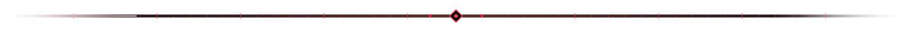
  

<!-- ───────────────────────── 01 · SOBRE NÓS ───────────────────────── -->

𝘚𝘰𝘮𝘰𝘴 𝘰𝘴 <b>Guris da T.I</b>: 𝘶𝘮 𝘨𝘳𝘶𝘱𝘰 𝘥𝘦 𝘢𝘮𝘪𝘨𝘰𝘴 𝘶𝘯𝘪𝘷𝘦𝘳𝘴𝘪𝘵𝘢́𝘳𝘪𝘰𝘴 𝘲𝘶𝘦 𝘶𝘯𝘦 𝘵𝘦𝘤𝘯𝘰𝘭𝘰𝘨𝘪𝘢, 𝘦𝘥𝘶𝘤𝘢𝘤̧𝘢̃𝘰 𝘦 𝘤𝘳𝘪𝘢𝘤̧𝘢̃𝘰 𝘥𝘦 𝘤𝘰𝘯𝘵𝘦𝘶́𝘥𝘰 𝘱𝘢𝘳𝘢 𝘢𝘫𝘶𝘥𝘢𝘳 𝘦 𝘵𝘳𝘢𝘻𝘦𝘳 𝘢𝘭𝘦𝘨𝘳𝘪𝘢 𝘦 𝘦𝘥𝘶𝘤𝘢𝘤̧𝘢̃𝘰 𝘱𝘢𝘳𝘢 𝘮𝘶𝘪𝘵𝘰𝘴 𝘣𝘳𝘢𝘴𝘪𝘭𝘦𝘪𝘳𝘰𝘴 𝘩𝘰𝘫𝘦.
  

<b> 𝘈𝘵𝘶𝘢𝘭𝘮𝘦𝘯𝘵𝘦, 𝘢𝘵𝘶𝘢𝘮𝘰𝘴 𝘦𝘮 𝘥𝘪𝘷𝘦𝘳𝘴𝘢𝘴 𝘢́𝘳𝘦𝘢𝘴 𝘥𝘢 𝘵𝘦𝘤𝘯𝘰𝘭𝘰𝘨𝘪𝘢 𝘦 𝘥𝘢 𝘤𝘳𝘪𝘢𝘵𝘪𝘷𝘪𝘥𝘢𝘥𝘦, 𝘤𝘰𝘮𝘰 𝘥𝘦𝘴𝘦𝘯𝘷𝘰𝘭𝘷𝘦𝘥𝘰𝘳𝘦𝘴, 𝘱𝘳𝘰𝘨𝘳𝘢𝘮𝘢𝘥𝘰𝘳𝘦𝘴, 𝘴𝘵𝘳𝘦𝘢𝘮𝘦𝘳𝘴, 𝘦𝘥𝘪𝘵𝘰𝘳𝘦𝘴, 𝘥𝘦𝘴𝘪𝘨𝘯𝘦𝘳𝘴 𝘦 𝘢𝘳𝘵𝘪𝘴𝘵𝘢𝘴 𝘥𝘪𝘨𝘪𝘵𝘢𝘪𝘴. 𝘔𝘢𝘴, 𝘢𝘤𝘪𝘮𝘢 𝘥𝘦 𝘲𝘶𝘢𝘭𝘲𝘶𝘦𝘳 𝘵𝘪́𝘵𝘶𝘭𝘰 𝘰𝘶 𝘱𝘳𝘰𝘧𝘪𝘴𝘴𝘢̃𝘰, 𝘴𝘰𝘮𝘰𝘴 𝘦𝘴𝘵𝘶𝘥𝘢𝘯𝘵𝘦𝘴, 𝘦 𝘵𝘦𝘮𝘰𝘴 𝘮𝘶𝘪𝘵𝘰 𝘰𝘳𝘨𝘶𝘭𝘩𝘰 𝘥𝘪𝘴𝘴𝘰. 𝘕𝘰𝘴𝘴𝘢 𝘵𝘳𝘢𝘫𝘦𝘵𝘰́𝘳𝘪𝘢 𝘯𝘢𝘴𝘤𝘦𝘶 𝘥𝘦 𝘶𝘮𝘢 𝘱𝘢𝘪𝘹𝘢̃𝘰 𝘦𝘮 𝘤𝘰𝘮𝘶𝘮 𝘱𝘦𝘭𝘢 𝘵𝘦𝘤𝘯𝘰𝘭𝘰𝘨𝘪𝘢, 𝘲𝘶𝘦, 𝘤𝘰𝘮 𝘰 𝘱𝘢𝘴𝘴𝘢𝘳 𝘥𝘰 𝘵𝘦𝘮𝘱𝘰, 𝘴𝘦 𝘵𝘳𝘢𝘯𝘴𝘧𝘰𝘳𝘮𝘰𝘶 𝘦𝘮 𝘶𝘮 𝘤𝘰𝘮𝘱𝘳𝘰𝘮𝘪𝘴𝘴𝘰 𝘢𝘪𝘯𝘥𝘢 𝘮𝘢𝘪𝘰𝘳 𝘤𝘰𝘮 𝘰 𝘦𝘯𝘴𝘪𝘯𝘰, 𝘢 𝘤𝘰𝘭𝘢𝘣𝘰𝘳𝘢𝘤̧𝘢̃𝘰 𝘦 𝘰 𝘤𝘰𝘮𝘱𝘢𝘳𝘵𝘪𝘭𝘩𝘢𝘮𝘦𝘯𝘵𝘰 𝘥𝘦 𝘤𝘰𝘯𝘩𝘦𝘤𝘪𝘮𝘦𝘯𝘵𝘰.

Mantemos nossos repositórios <b>abertos</b> para consulta e avaliação. 
Seja você educador, recrutador, estudante ou curioso, fique à vontade para explorar o que temos construído.


 


 


 

<!-- ───────────────────────── 02 · STACK ───────────────────────── -->

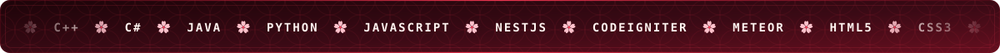

  


ver stack em texto

 

| Camada | Tecnologias |
| :--- | :--- |
| **Back-end** | NestJS · CodeIgniter · Meteor · JavaScript · Python |
| **Front-end** | HTML5 · CSS3 · JavaScript |
| **Banco de dados** | PostgreSQL |
| **Games & 3D** | Unreal Engine · C++ · Blender |
| **Design & Edição** | Photoshop |
| **Infra & Ambiente** | Linux · Debian · Ubuntu · Apache · VS Code |

 

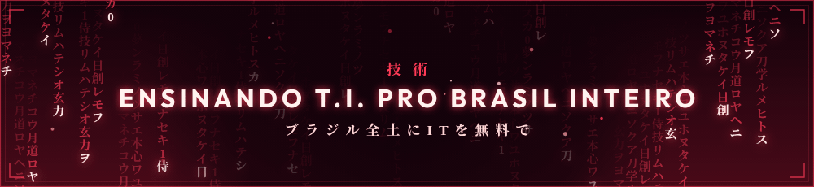

<!-- ───────────────────────── 03 · ATIVIDADE ───────────────────────── -->

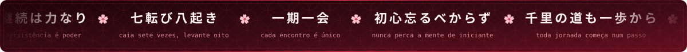

 

<!-- ───────────────────────── 04 · EQUIPE ───────────────────────── -->

 

<a href="https://github.com/jaobom006"></a>
<a href="https://github.com/midasrei68-dev"></a>
<a href="https://github.com/mwtheuskkj"></a>
<a href="https://github.com/Massarubash"></a>
<a href="https://github.com/lucasgracaleandro-arch"></a>

<a href="https://github.com/Luucasy"></a>

 

▸ Pretendemos expandir a equipe no futuro. Toda ajuda é bem-vinda, de perto ou de longe. •ᴗ•

 

<!-- ───────────────────────── 05 · GENNISCODE ───────────────────────── -->

Você deve estar se perguntando: <i>como um grupo de seis amigos, incluindo um japa "falsificado" e outros cinco entusiastas apaixonados por tecnologia, resolveu mudar o rumo da educação digital no Brasil?</i>

<b>A resposta é simples: inconformismo aliado a muita paixão.</b>

Nascemos da vontade genuína de ajudar as pessoas. Cansados de ver o conhecimento em T.I. trancado a sete chaves por mensalidades abusivas e promessas falsas, decidimos fazer diferente. O GennisCode não é apenas um projeto: é um movimento. Somos a prova de que tecnologia de ponta, educação de qualidade e o sonho de construir uma carreira sólida não devem ser privilégios para poucos.

Nossa missão é direta e sem pausas: levar educação tecnológica <b>gratuita e acessível para o Brasil inteiro</b>, do zero absoluto até o mercado de trabalho, entregando certificação ao final da jornada. Aqui, qualquer pessoa, independentemente de onde veio ou de suas condições, pode dar o primeiro passo para transformar o próprio futuro.

 


 

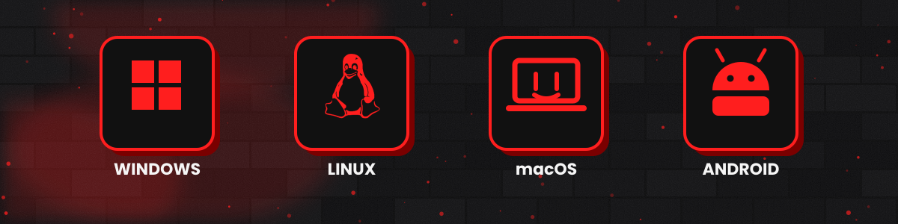

Os dispositivos 3D acima representam as plataformas onde o GennisCode roda: <b>Linux, Windows, macOS e Android</b>. Aprenda no PC, no notebook ou no celular, sem barreira e sem custo.

 


 

Quer conhecer um pouquinho mais sobre a gente e nossas propostas?

<b>GennisCode</b> · <i>Aprenda, construa e compartilhe</i> 
Tecnologia é melhor quando é compartilhada. :)

<code>Projeto ainda em desenvolvimento :]</code>

 

<!-- ───────────────────────── 06 · COMUNIDADE ───────────────────────── -->

<a href="https://fluxer.gg/uHuHUyOJ"></a>

Nossa comunidade brasileira de T.I. vive no <b>Fluxer</b>: tire dúvidas, aprenda do zero e cresça junto com a gente. 
Acompanhe também no Instagram: <b>@guriz.mp4</b>

 

