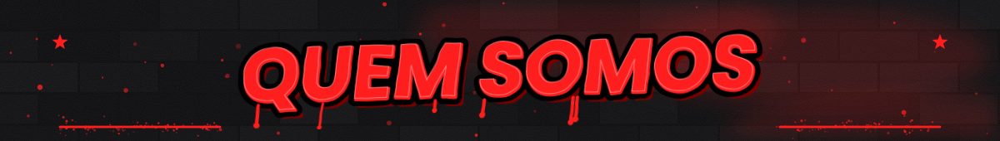
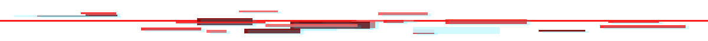
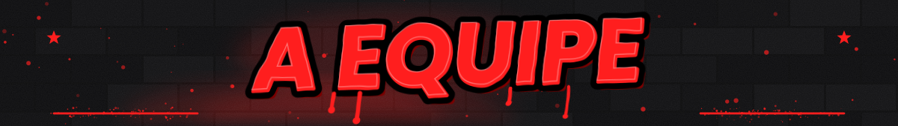
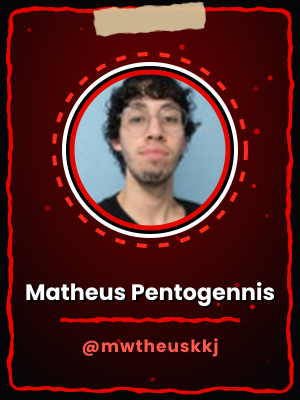
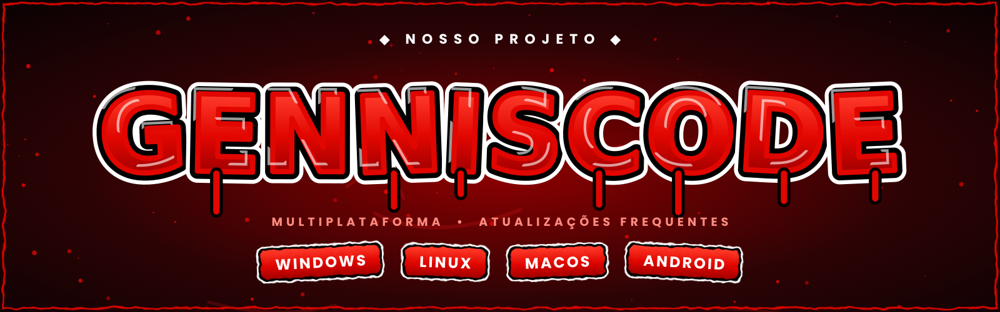
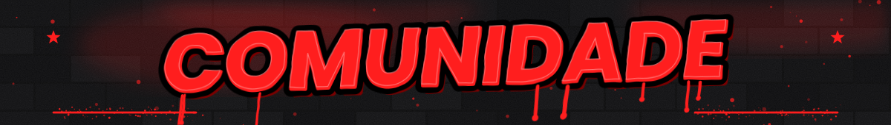
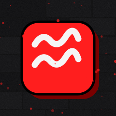
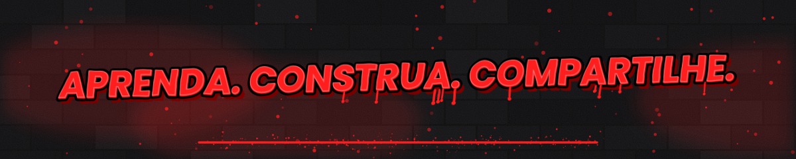

### 👋 Opa, bão? Seja bem-vindo(a) ao perfil dos **Guris da T.I**.

Somos os <b>Guris da T.I</b>: um coletivo de amigos universitários que une tecnologia, educação e criação de conteúdo. 
Atuamos como <b>desenvolvedores, streamers, editores, designers e estudantes</b>, com anos de vivência na área de T.I e um objetivo em comum: contribuir de forma ativa para a evolução da tecnologia no Brasil.

Nossa trajetória nasceu da paixão por tecnologia e se consolidou em um compromisso com o ensino e a colaboração. 
Hoje cursamos <b>Análise e Desenvolvimento de Sistemas</b> e <b>Ciência da Computação</b> na <b>Universidade Braz Cubas</b>, transformando ideias em projetos acadêmicos, pessoais e de empreendedorismo.

Mantemos nossos repositórios <b>abertos</b> para consulta e avaliação. 
Seja você educador, recrutador, estudante ou curioso, fique à vontade para explorar o que temos construído.

<table>
  <tr>
    <td align="center" valign="top"> <b>João Victor Guimarães</b> <a href="https://github.com/jaobom006">@jaobom006</a></td>
    <td align="center" valign="top"> <b>Gabriel Gonçalves</b> <a href="https://github.com/midasrei68">@midasrei68</a></td>
    <td align="center" valign="top"> <b>Matheus Pentogennis</b> <a href="https://github.com/mwtheuskkj">@mwtheuskkj</a></td>
  </tr>
  <tr>
    <td align="center" valign="top"> <b>Gustavo Gabriel F</b> <a href="https://github.com/Massarubash">@Massarubash</a></td>
    <td align="center" valign="top"> <b>Lucas da Graça</b> <a href="https://github.com/lucasgracalenadro-arch">@lucasgracalenadro-arch</a></td>
    <td align="center" valign="top"> <b>Lucas Siqueira</b> <a href="https://github.com/Luucasy">@Luucasy</a></td>
  </tr>
</table>

▸ Pretendemos expandir a equipe no futuro. Toda ajuda é bem-vinda, de perto ou de longe. •ᴗ•

 

O <b>GennisCode</b> é o nosso projeto: <b>multiplataforma e compatível com a maioria dos sistemas atuais</b>, e seguimos trabalhando em mais melhorias. 
Atualmente ele está disponível para <b>Windows</b>, <b>Linux</b>, <b>macOS</b> e <b>Android</b>.

O nosso projeto conta com <b>atualizações frequentes</b>, sempre para evitar bugs ou erros no sistema. 
Ele nasceu de um projeto universitário e é a nossa primeira iniciativa independente. Conheça, avalie e envie seu feedback: estamos sempre dispostos a ouvir, melhorar e compartilhar.

  

<b>Conheça a comunidade oficial dos Guris da T.I.</b> 
Uma comunidade 100% brasileira e independente, focada em levar a tecnologia até você e sempre estar com você.

<table>
  <tr>
    <td align="center">
       
      
    </td>
    <td align="center">
       
      
    </td>
  </tr>
</table>

Fluxer: <a href="https://fluxer.gg/uHuHUyOJ">fluxer.gg/uHuHUyOJ</a> &nbsp;•&nbsp; Instagram: <a href="https://instagram.com/guriz.mp4">@guriz.mp4</a>

  

<h5 align="left">⤷ Linguagens que mais utilizamos:</h5>

  
  
  
  
  
  
  
  
  

  
  
  
  
  
  
  
  
  
  
  
  
  
  
  
  

 

<h5 align="left">⤷ Sistemas &amp; ferramentas que utilizamos:</h5>

  
  
  
  
  
  
  
  
  

  
  
  
  
  
  
  
  
  
  
  
  
  

 

▸ Avalie e dê seu feedback. Estamos sempre dispostos a ouvir, melhorar e compartilhar. •ᴗ•

