


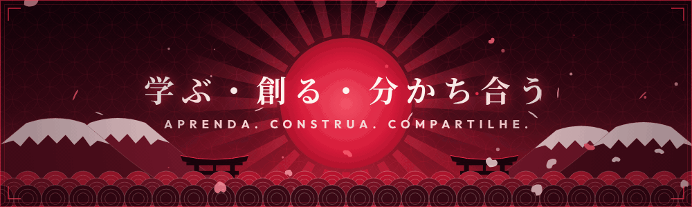

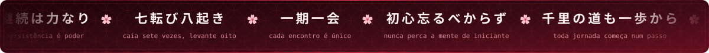

<!-- ───────────────────────── 01 · SOBRE NÓS ───────────────────────── -->

Somos a <b>N ☰ X U S</b>: um coletivo de amigos universitários que une tecnologia, educação e criação de conteúdo. 
Atuamos como <b>desenvolvedores, streamers, editores, designers e estudantes</b>, com anos de vivência na área de T.I e um objetivo em comum: contribuir de forma ativa para a evolução da tecnologia no Brasil.

Nossa trajetória nasceu da paixão por tecnologia e se consolidou em um compromisso com o ensino e a colaboração. 
Hoje cursamos <b>Análise e Desenvolvimento de Sistemas</b> e <b>Ciência da Computação</b> na <b>Universidade Braz Cubas</b>, transformando ideias em projetos acadêmicos, pessoais e de empreendedorismo.

Mantemos nossos repositórios <b>abertos</b> para consulta e avaliação. 
Seja você educador, recrutador, estudante ou curioso, fique à vontade para explorar o que temos construído.


 

 


 


 

<!-- ───────────────────────── 02 · STACK ───────────────────────── -->

  


ver stack em texto

 

| Camada | Tecnologias |
| :--- | :--- |
| **Back-end** | NestJS · CodeIgniter · Meteor · Java · C# · Python |
| **Front-end** | HTML5 · CSS3 · JavaScript |
| **Banco de dados** | PostgreSQL |
| **Games & 3D** | Unreal Engine · C++ · C# · Blender |
| **Design & Edição** | Photoshop |
| **Infra & Ambiente** | Linux · Debian · Ubuntu · Apache · C · VS Code |

 

 

  


ver sistemas em texto

 

| Grupo | Sistemas |
| :--- | :--- |
| **Debian / Ubuntu** | Ubuntu · Linux Mint · Pop!_OS · Debian |
| **Fedora & derivadas** | Fedora · Nobara KDE |
| **Desktop** | KDE Plasma · GNOME · Cinnamon · XFCE |
| **Servidor de vídeo** | Wayland · X11 |
| **Windows** | XP · 7 · 10 · 11 |
| **VM & Dual Boot** | VirtualBox · Dual Boot · WSL |

 

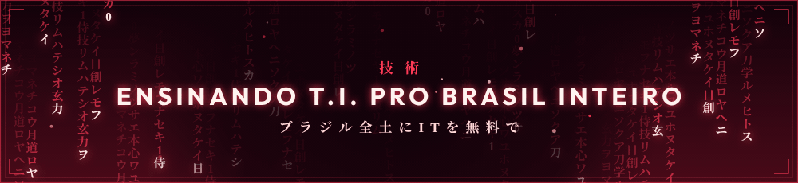

<!-- ───────────────────────── 03 · ATIVIDADE ───────────────────────── -->

<picture>
  <source media="(prefers-color-scheme: dark)" srcset="https://raw.githubusercontent.com/Massarubash/Massarubash/pacman-output/galaga-contribution-graph-dark.svg?game=galaga">
  <source media="(prefers-color-scheme: light)" srcset="https://raw.githubusercontent.com/Massarubash/Massarubash/pacman-output/galaga-contribution-graph.svg?game=galaga">
  
</picture>

 

<!-- ───────────────────────── 04 · EQUIPE ───────────────────────── -->

 

<a href="https://github.com/jaobom006"></a>
<a href="https://github.com/midasrei68-dev"></a>
<a href="https://github.com/mwtheuskkj"></a>
<a href="https://github.com/Massarubash"></a>
<a href="https://github.com/lucasgracaleandro-arch"></a>

<a href="https://github.com/Luucasy"></a>

 

▸ Pretendemos expandir a equipe no futuro. Toda ajuda é bem-vinda, de perto ou de longe. •ᴗ•

 

<!-- ───────────────────────── 05 · GENNISCODE ───────────────────────── -->

Você deve estar se perguntando: <i>como um grupo de seis amigos, incluindo um japa "falsificado" e outros cinco entusiastas apaixonados por tecnologia, resolveu mudar o rumo da educação digital no Brasil?</i>

<b>A resposta é simples: inconformismo aliado a muita paixão.</b>

Nascemos da vontade genuína de ajudar as pessoas. Cansados de ver o conhecimento em T.I. trancado a sete chaves por mensalidades abusivas e promessas falsas, decidimos fazer diferente. O GennisCode não é apenas um projeto: é um movimento. Somos a prova de que tecnologia de ponta, educação de qualidade e o sonho de construir uma carreira sólida não devem ser privilégios para poucos.

Nossa missão é direta e sem pausas: levar educação tecnológica <b>gratuita e acessível para o Brasil inteiro</b>, do zero absoluto até o mercado de trabalho, entregando certificação ao final da jornada. Aqui, qualquer pessoa, independentemente de onde veio ou de suas condições, pode dar o primeiro passo para transformar o próprio futuro.

 

 


Os dispositivos 3D acima representam as plataformas onde o GennisCode roda: <b>Linux, Windows, macOS e Android</b>. Aprenda no PC, no notebook ou no celular, sem barreira e sem custo.

 

Quer conhecer um pouquinho mais sobre a gente e nossas propostas?

<b>GennisCode</b> · <i>Aprenda, construa e compartilhe</i> 
Tecnologia é melhor quando é compartilhada. :)

<code>Projeto ainda em desenvolvimento :]</code>

 

<!-- ───────────────────────── 06 · COMUNIDADE ───────────────────────── -->

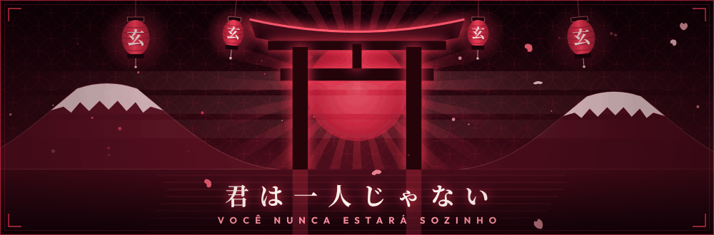

<a href="https://fluxer.gg/uHuHUyOJ"></a>

Nossa comunidade brasileira de T.I. vive no <b>Fluxer</b>: tire dúvidas, aprenda do zero e cresça junto com a gente. 
Acompanhe também no Instagram: <b>@nexus.bash</b>

 


